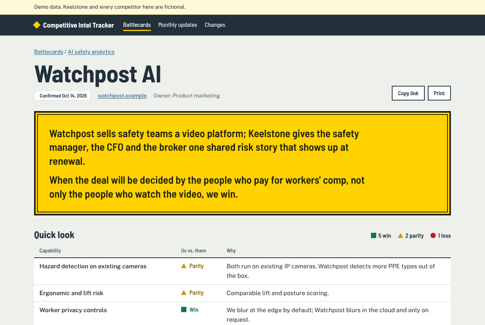

# Competitive Intel Tracker

A competitive intelligence engine your sales team uses without leaving Slack. Reps post what they hear
in a channel, an admin approves it, and it lands on a battlecard with a link reps can drop into any
thread. Every week it checks competitors' sites for changes. On the first Tuesday of every month it
writes the update reps read before their next call.

**[Open the live demo](https://jamesallgood99.github.io/competitive-intel-tracker/)** · Built by
[James Allgood](https://www.linkedin.com/in/jamesallgood)



## Why this exists

Most competitive programs die the same way. Someone builds forty battlecards in a sprint, sales
leadership announces them in all-hands, and six months later the cards describe a market that no longer
exists. Meanwhile the best intel in the company sits in a rep's head after a call, or in a Slack thread
nobody will scroll back to.

At CompScience, an AI-powered workers' comp platform, I built a Slack-based agentic version of this to
fix both problems. The reps were already the best sensors we had. They just needed a place to put what
they heard that took ten seconds, and a reason to trust that it would show up somewhere useful. The
agent did the filing, the admin did the judging, and the battlecards stayed current because keeping them
current stopped being a project.

This repo rebuilds that system from scratch, in the open. The sample market is fictional: Keelstone (the
same made-up product from my [GTM Simulator](https://github.com/jamesallgood99/gtm-simulator)) and
twelve made-up competitors. No CompScience data is in this repo.

## How reps use it

Reps don't learn a new tool. Everything happens in Slack.

| They do this | This happens |
|---|---|
| Post intel in **#competitive-intel** ("Watchpost offered a free 90-day pilot to block our eval") | Claude tags the competitor, rewrites it neutrally for the card, and sends it to the admin. The rep gets a thread reply saying who's reviewing it. |
| Wait | The admin approves, edits or rejects it from their DMs. Approved intel goes on the card and the rep gets a ✅ and the link. Rejections go to the rep privately, never in the channel. |
| Type `/battlecard watchpost` | They get the card's link and its two-sentence positioning statement, with a button to share it in the channel. |
| Type `/battlecard request Acme Safety - lost two deals to them` | The admin approves or rejects the request. On approval, Claude drafts the card and the rep hears when it's live. |
| Read the monthly update | First Tuesday of the month, in the channel: three things to know, then the details. |

## How the admin runs it

The admin is the editor. Nothing reaches a rep without their approval.

- **Intel:** approve, edit or reject each submission from a DM.
- **New battlecards:** approving a request opens a form to pick the competitive category and approve the
  exact pages and searches the tracker may use for that competitor. Claude drafts the card from those
  sources and opens a pull request. Merging it publishes the card and announces it in the channel.
- **Change alerts:** major changes from the weekly scan (a new product, a dropped SOC 2 claim) arrive in
  the admin's DMs the day they're found.
- **Stale cards:** any card nobody has confirmed in 90 days gets a warning on the page and a "Mark current"
  button in the admin's DMs.
- **The monthly update:** it arrives as a draft. One button publishes it to the channel.

Every approval is a commit, so every change to every card has an author, a date and a history.

## Competitive categories

You track competitors in categories, because different kinds of competitors threaten you differently.
At CompScience those were insurance carriers, insurtechs and AI safety analytics companies. A company
with several product lines would use one category per line. A company with B2B and B2C motions would
split it that way.

Each category gets its own capability list for the battlecard scorecard, and the monthly update picks the
top movers per category, so a busy month among carriers can't drown out the one insurtech launch that
matters. Categories live in `config/tracker.config.json`.

## The battlecards

Each card has a link that never changes: `/battlecards/<competitor>/`. The top half is what a rep reads
in sixty seconds before a call. The bottom half is the reference.

**Above the fold**
- **Positioning statement:** two sentences, set like a safety sign so nobody misses it: how they position, and how and when we win.
- **Quick look:** one row per capability, marked win, parity or loss. The shapes come from safety signage (green square, yellow triangle, red circle) so the scorecard reads without color.
- **Why we win** with a proof point for each, and **where they win**, so reps aren't ambushed.
- **Objection handling:** what they'll say, what you say.
- **Questions to ask the prospect:** each one points at a gap in their offer.
- **Field intel** from reps, newest first and credited.

**Below the fold**
- **What they say:** their current messaging, scraped weekly, with a log of what changed.
- **Product lineup** and **compliance, security and privacy claims**, side by side with ours.
- **What customers say:** G2, Capterra and Gartner Peer Insights feedback grouped into positive and negative themes.
- **Company snapshot** and the **approved sources** the tracker is allowed to use.

Employee sentiment from Glassdoor, including CEO approval, is collected but kept off rep-facing cards by
default. It's a strong signal for the admin about turnover and roadmap risk, and a weak look for a rep to
quote in front of a prospect. Turn it on with `site.showEmployeeSentiment` if your site is private.

## The monthly update

It runs on the first Tuesday of the month and covers everything since the last one.

1. **TL;DR:** the three things a rep most needs to know.
2. **The market:** industry trends, regulatory updates, mergers and acquisitions, and industry health, each researched fresh with web search.
3. **Competitor movers:** the top three movers in each category, each with what changed and what reps should do about it. We track every competitor, but only comment on the ones that moved.

"Moved" is scored, not guessed. Each change gets weight by severity and type (a new product outweighs a
messaging tweak), and the weights live in the config.

## What it watches, and what it won't scrape

For each competitor, the weekly scan reads only the pages the admin approved, checks robots.txt first,
and identifies itself honestly. It extracts the product lineup, the main messaging points and every
compliance, security and privacy claim, then compares them with last week's.

G2, Capterra, Gartner Peer Insights and Glassdoor prohibit automated scraping, so the tracker never
fetches them, even if someone approves the URL. Review sources use one of three methods instead:
**search** (Claude web search summarizing what's publicly indexed), **upload** (an export the admin drops
in `data/uploads/`) or **api** (a licensed API such as G2's, when you have one).

## Try the demo locally

```bash
npm install
npm run build
npm run serve      # http://localhost:4173
npm test
```

The jobs run dry without an API key, so you can see what they'd do:

```bash
node src/jobs/monthly.js --date 2026-11-03   # shows the top movers it would write about
node src/jobs/scrape.js                      # lists every approved page it would check
```

## Set it up for your team

1. **Fork this repo** and point `config/tracker.config.json` at your company: name, proof points, categories and their capabilities, Slack channel, admin IDs.
2. **Replace the demo data:** delete `data/competitors/*`, `data/changes.json`, `data/requests.json` and `data/updates/*`. Then add competitors through Slack with `/battlecard request`.
3. **Publish the site:** Settings → Pages → Source: GitHub Actions. If your intel is sensitive (it is), put the site behind your SSO instead. GitHub Pages sites are public unless you're on Enterprise Cloud.
4. **Create the Slack app** from `slack/manifest.yml` and run the bot. [docs/slack-setup.md](docs/slack-setup.md) walks through it, including the secrets.
5. **Add secrets** to the repo for the scheduled jobs: `ANTHROPIC_API_KEY` and `SLACK_BOT_TOKEN`.

[docs/admin-guide.md](docs/admin-guide.md) covers the admin's week, and `skill/competitive-intel/` is a
Claude skill with the same prompts and formats, for when you'd rather do the work in a Claude chat.

## Repo layout

```
config/tracker.config.json   your company, categories, capabilities, Slack, schedule, mover weights
data/
  competitors/<slug>.json    one battlecard per competitor (the knowledge base)
  changes.json               every change the tracker has recorded
  updates/<yyyy-mm>.json     monthly updates
  requests.json              battlecard requests and decisions
  snapshots/                 last scrape per competitor, for diffing
src/
  bot/                       the Slack bot (Bolt): intel intake, /battlecard, requests, admin buttons
  jobs/                      scheduled work: scrape, reviews, monthly update, card drafting, announcements
  lib/                       prompts, Claude client, GitHub commits, diffing, movers, robots.txt
site/                        builds the battlecard site from data/ (no framework)
skill/competitive-intel/     the Claude skill
.github/workflows/           site build, weekly scan, monthly update, card drafting, tests
```

## Defaults you can change

| Decision | Default | Where |
|---|---|---|
| Scorecard scale | Win, parity, loss. Claude proposes, the admin approves. | `src/lib/prompts.js` |
| Employee sentiment on cards | Off | `site.showEmployeeSentiment` |
| Stale card warning | 90 days | `site.staleAfterDays` |
| Movers per category | 3 | `monthly.topMoversPerCategory` |
| Monthly update day | First Tuesday | `monthly.weekday` |
| Model | `claude-sonnet-5-5` | `claude.model`, or the `CLAUDE_MODEL` variable |

## Let's talk

If your battlecards are older than your last pricing change, or your best competitive intel lives in
your reps' heads, I'd like to hear about it. I'm open to full-time marketing leadership roles and
advisory work, and happy to start with a conversation about how your team learns what competitors are
doing. Find me on [LinkedIn](https://www.linkedin.com/in/jamesallgood).

## License

MIT. Fork it, point it at your own market, and let your reps do what they already do best.
